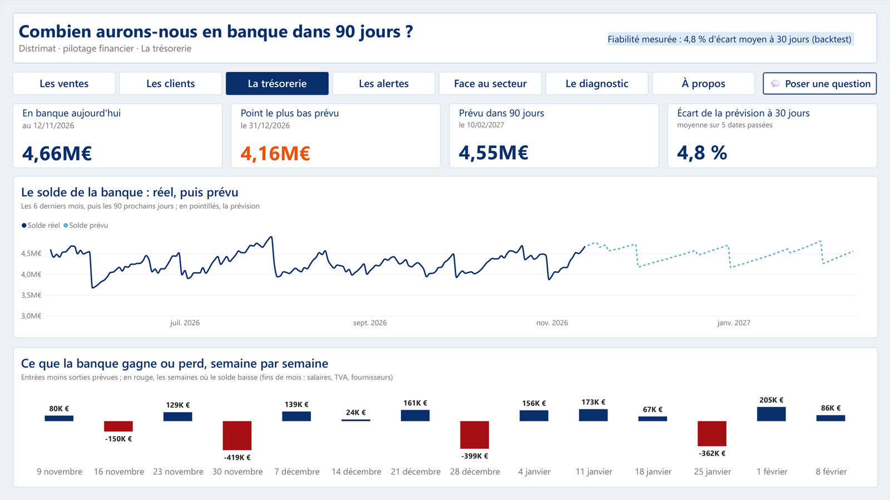
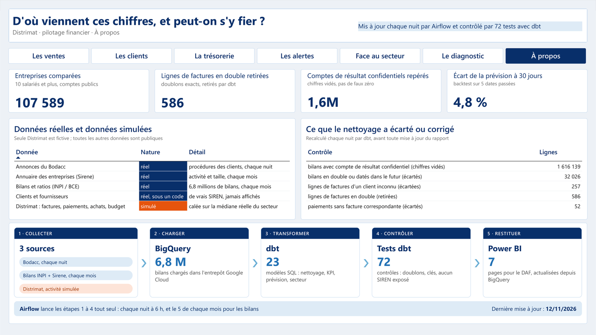
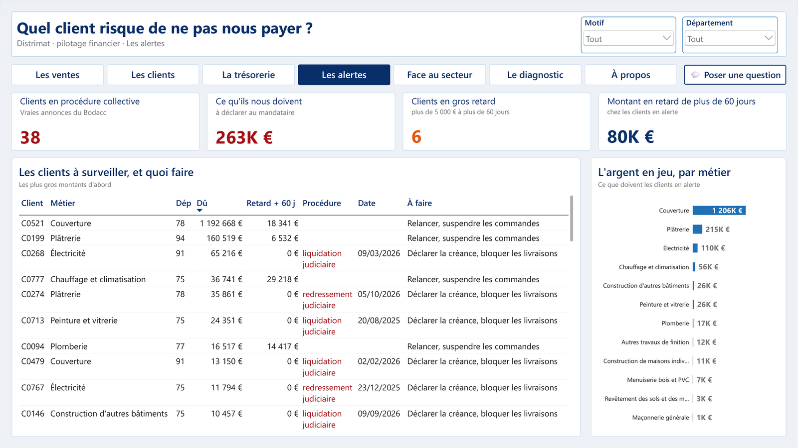
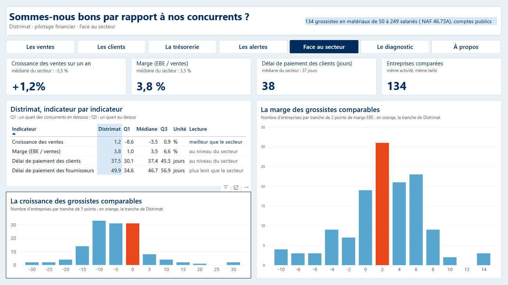
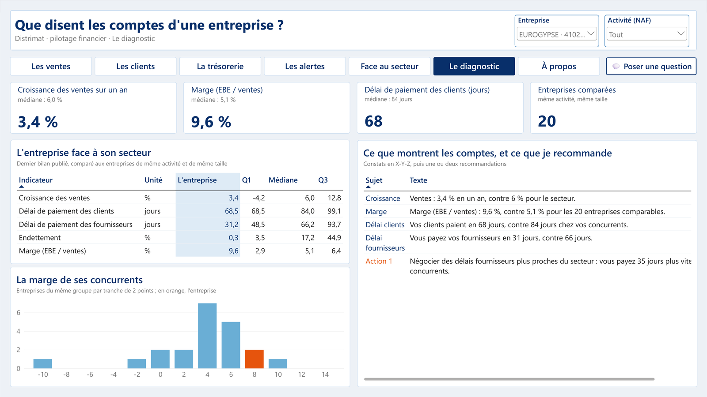
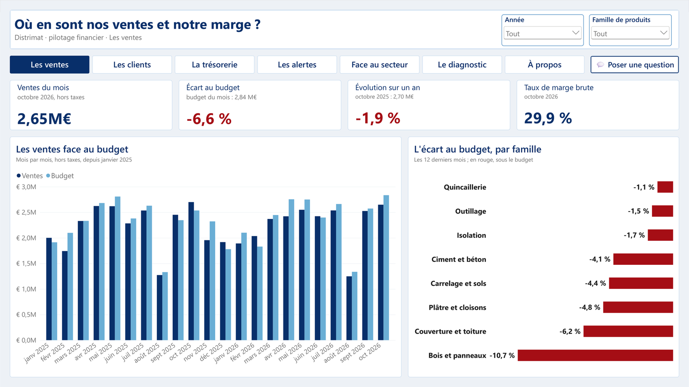
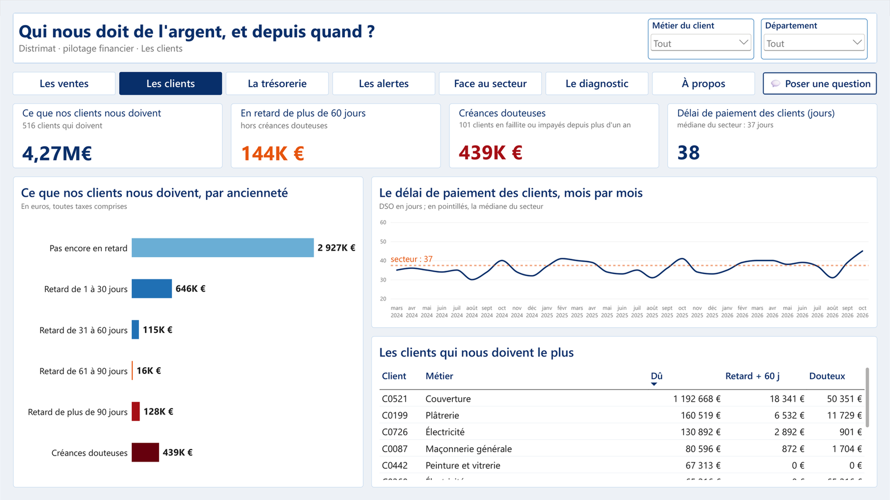

# 📊 Pilotage financier d'une PME : trésorerie, impayés et comparaison au secteur


Un grossiste en matériaux d'Île-de-France voulait savoir chaque matin où en sont ses ventes, qui lui doit de l'argent, combien il aura en banque dans 90 jours et s'il fait mieux que ses concurrents. **Une chaîne Airflow, dbt et BigQuery recalcule tout chaque nuit, et la prévision de trésorerie tombe à 4,8 % du solde réel à 30 jours.**



---

## 📖 Contexte

Le directeur financier d'une PME de 50 à 99 salariés (grossiste en matériaux, cas fictif) pilote avec des exports Excel refaits à la main chaque mois. Il découvre les clients en difficulté trop tard et ne sait pas s'il paie ses fournisseurs plus vite que ses concurrents.

**Ses questions :**

| # | La question | La table qui répond |
|---|---|---|
| 1 | Où en sont nos ventes et notre marge, face au budget ? | `kpi_mensuels`, `ventes_familles` |
| 2 | Qui nous doit de l'argent, et depuis combien de temps ? | `balance_agee` |
| 3 | Combien aurons-nous en banque dans 90 jours ? | `prevision_tresorerie`, `tresorerie_jour` |
| 4 | Quel client risque de ne pas nous payer ? | `alertes_clients` |
| 5 | Sommes-nous meilleurs ou moins bons que nos concurrents ? | `position_distrimat`, `benchmark_entreprises` |

---

## 🎯 Ce que j'ai fait

1. **Collecté trois sources publiques réelles** : 6,8 millions de bilans (ratios INPI / BCE), l'annuaire Sirene et les annonces légales du Bodacc.
2. **Créé l'activité de test de l'entreprise** (factures, paiements, achats, budget), calée sur la **médiane réelle des grossistes en matériaux** de sa taille : chiffre d'affaires, marge, délais clients et fournisseurs.
3. **Chargé le tout dans BigQuery**, avec le même code en local sur DuckDB.
4. **Orchestré la chaîne avec Airflow** : un DAG chaque nuit à 6 h (Bodacc, journée de l'entreprise, chargement, dbt, alerte du matin) et un DAG le 5 de chaque mois (bilans et annuaire).
5. **Modélisé avec dbt** en trois couches (staging, intermediate, marts) : 23 modèles, 6 référentiels, **43 tests**.
6. **Construit le tableau de bord Power BI** connecté à BigQuery.
7. **Ajouté un assistant IA** qui répond aux questions du directeur financier en écrivant lui-même la requête SQL, dans une page web, puis **mesuré sa fiabilité** : 48 réponses justes sur 48.



---

## 🔍 Résultats clés

### 1️⃣ Une prévision de trésorerie vérifiée dans le passé

La prévision à 90 jours a été refaite à 5 dates passées, avec seulement ce qu'on savait à l'époque, puis comparée au solde réel.

| Horizon | Écart moyen avec le solde réel |
|---|---|
| 30 jours | **4,8 %** |
| 60 jours | 5,8 % |
| 90 jours | 4,5 % |

Plutôt qu'un délai de paiement moyen, la prévision répartit chaque facture ouverte selon la façon dont les factures du même âge ont vraiment été payées sur 12 mois.

### 2️⃣ 4,27 millions d'euros dus par 516 clients, dont 38 en procédure collective

La balance âgée classe chaque euro dû par tranche de retard. Chaque nuit, les vraies annonces du Bodacc signalent les clients qui entrent en redressement ou en liquidation : **38 clients** sont concernés, et **44 alertes** portent sur **1,69 million d'euros**, chacune avec l'action à mener.

```sql
-- alertes_clients : procédure au Bodacc avec de l'argent dû, ou plus de 5 000 € en retard de plus de 60 jours
select
    code_client,
    encours_ttc,
    round(retard_61_90 + retard_plus_90, 2) as retard_plus_60_ttc,
    procedure_bodacc,
    case
        when procedure_bodacc is not null then 'procédure collective : déclarer la créance au mandataire et bloquer les livraisons'
        else 'retard important : relancer par téléphone et suspendre les nouvelles commandes'
    end as action
from {{ ref('balance_agee') }}
where (procedure_bodacc is not null and encours_ttc > 0)
   or (retard_61_90 + retard_plus_90 > 5000)
```



### 3️⃣ Face à 134 concurrents directs

L'entreprise est comparée aux grossistes en matériaux de 50 à 249 salariés qui publient leurs comptes (médiane et quartiles) :

| Indicateur | L'entreprise | Médiane du secteur | Lecture |
|---|---|---|---|
| Croissance des ventes | +1,2 % | −3,5 % | meilleure que le secteur |
| Marge (EBE / ventes) | 3,8 % | 3,5 % | au niveau |
| Délai de paiement des clients | 37,5 jours | 37,4 jours | au niveau |
| Délai de paiement des fournisseurs | 49,9 jours | 46,7 jours | plus lente que le secteur |

La même comparaison tourne pour **469 041 entreprises françaises** (1 906 groupes de concurrents, même activité et même taille).



Une page de diagnostic applique la même méthode à n'importe quelle entreprise qui publie ses comptes : constats chiffrés, puis une ou deux recommandations.



### 4️⃣ La qualité des données mesurée, pas supposée

| Contrôle | Lignes |
|---|---|
| Lignes de factures en double (retirées) | 586 |
| Lignes de factures d'un client inconnu (écartées) | 257 |
| Paiements sans facture correspondante (écartés) | 52 |
| Bilans en double ou datés dans le futur (écartés) | 32 026 |
| Bilans avec compte de résultat confidentiel (chiffres vidés) | 1 616 139 |

Les **72 contrôles dbt** passent sur BigQuery et sur DuckDB, avec des résultats identiques.

### 5️⃣ Le tableau de bord du directeur financier

7 pages, une question par page : les ventes, les clients, la trésorerie, les alertes, la comparaison au secteur, le diagnostic d'une entreprise et la provenance des chiffres. Les 15 chiffres clés ont été recontrôlés un par un par une requête SQL dans BigQuery.





### 6️⃣ Un assistant IA pour le directeur financier, testé 48 fois

Le directeur financier pose sa question en français (« Quels clients nous doivent le plus d'argent ? ») dans une page web : l'assistant (Gemini) écrit la requête SQL, la fait vérifier par des garde-fous, l'exécute sur l'entrepôt et répond en deux phrases, avec un graphique, le tableau des chiffres et la requête utilisée.

- **Le contexte** : un dictionnaire métier lui donne les définitions de l'entreprise (hors taxes ou TTC, date de référence, DSO sur 12 mois, marge brute et marge d'EBE, encours à date, comparaison au secteur).
- **Les garde-fous** : lecture seule, une seule requête à la fois, seulement les tables de pilotage, aucun nom ni SIREN de client ; toute demande de modification est refusée.
- **La vérification** : 13 questions de chiffres comparées à une requête SQL écrite à la main, et 3 questions pièges, le tout posé 3 fois de suite, car une IA ne répond pas toujours de la même façon.

**Résultat : 48 réponses justes sur 48** (39 chiffres exacts sur 39, 9 demandes interdites refusées sur 9). Pour y arriver, chaque erreur trouvée par les tests a été expliquée, corrigée dans le dictionnaire, puis retestée :

| Erreur trouvée | Cause | Correction |
|---|---|---|
| Refusait de comparer la marge au secteur | il ne savait pas où se trouve la comparaison | la table du secteur décrite dans le dictionnaire |
| Refusait « quels clients nous doivent le plus » | il croyait qu'on lui demandait des noms | règle : le code client est autorisé, le nom ne l'est pas |
| Point bas de trésorerie faux | il prenait la fin de la prévision comme « date du jour » | règle sur la date de référence et sur le point bas |
| Marge brute (30 %) comparée à la marge d'EBE du secteur (3,5 %) | deux marges confondues | règle qui sépare les deux marges |
| Encours de fin octobre au lieu d'aujourd'hui | deux chiffres proches, à deux dates | règle sur la bonne source selon la date |
| DSO calculé sur 13 mois au lieu de 12 | `>=` au lieu de `>` dans le filtre de dates | règle écrite avec la bonne condition |

Le détail question par question est dans [`tests_ia/RESULTATS.md`](tests_ia/RESULTATS.md). En entreprise, la page serait hébergée sur Google Cloud (Cloud Run) et lirait directement BigQuery, avec Gemini via Vertex AI pour que les données restent dans le projet de l'entreprise.

---

## 💡 Conclusion et recommandations

> **Les ventes progressent quand le secteur recule, mais l'argent dû reste concentré sur peu de clients, dont une partie est déjà en procédure.**

1. **Déclarer sans attendre les créances des 38 clients en procédure** auprès du mandataire : le délai légal est de deux mois après la publication au Bodacc.
2. **Relancer en priorité les 44 clients en alerte** (1,69 million d'euros), en commençant par les retards de plus de 90 jours.
3. **Garder l'avance sur les fournisseurs** : l'entreprise les paie 3 jours plus tard que la médiane, c'est de la trésorerie gagnée sans pénalité tant que les délais légaux sont tenus.

---

## 🧪 Données réelles et données simulées

| Réel | Simulé |
|---|---|
| 6,8 millions de bilans publics et l'annuaire Sirene | l'entreprise, fictive |
| les annonces du Bodacc | ses factures, paiements, achats et son budget |
| les médianes du secteur sur lesquelles l'entreprise est calée | |

Aucune vraie entreprise ne reçoit de données de test : les clients n'apparaissent que sous un code, la correspondance reste hors du dépôt, et un test dbt vérifie qu'aucun SIREN n'apparaît dans les tables du pilotage.

---

## 🛠️ Technologies utilisées

- **Python 3.12** : collecte des API publiques, création de l'activité de test, chargement
- **Apache Airflow 3** : 2 DAG planifiés (quotidien et mensuel)
- **Google BigQuery (GCP)** : entrepôt de données, compte de service
- **dbt** (dbt-bigquery et dbt-duckdb) : modèles en couches, macros pour les deux entrepôts, 43 tests
- **DuckDB** : le même entrepôt en local
- **Power BI** : tableau de bord connecté à BigQuery, mesures DAX
- **Gemini (Google)** : assistant IA en lecture seule, évalué sur 48 réponses
- **FastAPI, HTML et JavaScript** : la page de l'assistant

---

## 🚀 Lancer le projet

```bash
git clone https://github.com/Heltondsm/pilotage-financier-pme.git
cd pilotage-financier-pme
python3.12 -m venv .venv && source .venv/bin/activate
pip install "apache-airflow==3.3.2" --constraint "https://raw.githubusercontent.com/apache/airflow/constraints-3.3.2/constraints-3.12.txt"
pip install -r requirements.txt
source activer.sh
python telecharger_referentiels.py
python constituer_distrimat.py
python collecter_bodacc.py && python simuler.py && python charger.py --cible local --referentiels
cd dbt && dbt seed --profiles-dir . && dbt build --profiles-dir . && cd ..
airflow standalone
```

Pour BigQuery : renseigner le projet GCP et la clé du compte de service dans `activer.sh`, puis `python charger.py --cible bigquery --referentiels` et `dbt build --profiles-dir . --target bigquery`.

Pour l'assistant IA : mettre `export GEMINI_API_KEY="…"` dans `secrets.sh` (clé gratuite sur aistudio.google.com), puis `python serveur_assistant.py` et ouvrir http://localhost:8501. Les tests : `python -m tests_ia.evaluer_assistant --tours 3`.

---

## 📂 Structure du projet

```
.
├── telecharger_referentiels.py   # bilans INPI / BCE + annuaire Sirene
├── constituer_distrimat.py       # l'entreprise de test, calée sur la médiane de son secteur
├── collecter_bodacc.py           # les annonces légales des clients et fournisseurs
├── simuler.py                    # factures, paiements, achats, budget
├── charger.py                    # vers DuckDB ou BigQuery
├── backtest.py                   # la prévision refaite dans le passé
├── alerter.py                    # l'alerte du matin
├── assistant.py                  # l'assistant IA : question en français -> SQL -> réponse
├── serveur_assistant.py          # le serveur de la page de l'assistant (FastAPI)
├── interface/                    # la page de l'assistant (HTML, CSS, JavaScript)
├── tests_ia/                     # l'évaluation de l'assistant (16 questions, 3 tours)
├── dags/                         # pilotage_quotidien, referentiels_mensuel
├── dbt/
│   ├── models/staging/           # 8 vues nettoyées
│   ├── models/intermediate/      # statut des factures, flux de trésorerie
│   ├── models/marts/             # KPI, balance âgée, alertes, prévision, comparaison au secteur
│   └── tests/                    # calage sur le secteur, aucun SIREN exposé
└── dashboard/                    # rapport Power BI et thème
```

**Sources :** [ratios INPI / BCE](https://data.economie.gouv.fr/explore/dataset/ratios_inpi_bce/) · [Sirene (INSEE)](https://www.sirene.fr/) · [Bodacc](https://www.bodacc.fr/)

---

## 📈 Compétences démontrées

### Ingénierie des données
- ✅ Chaîne orchestrée avec Airflow, planifiée chaque nuit et chaque mois
- ✅ Entrepôt BigQuery sur Google Cloud, même code en local sur DuckDB
- ✅ Modélisation dbt en trois couches, macros adaptées aux deux entrepôts

### Qualité des données
- ✅ 43 tests dbt : unicité, clés, calage sur le secteur, aucun SIREN exposé
- ✅ Doublons, lignes orphelines et comptes confidentiels comptés et traités

### Analyse financière
- ✅ Balance âgée, DSO, créances douteuses, alertes de procédures collectives
- ✅ Prévision de trésorerie à 90 jours vérifiée par backtest
- ✅ Comparaison aux concurrents par médiane et quartiles

### Restitution
- ✅ Tableau de bord Power BI pour un directeur financier, recommandations chiffrées

### IA appliquée
- ✅ Assistant IA qui écrit et exécute ses requêtes SQL, encadré par un dictionnaire métier et des garde-fous
- ✅ Fiabilité mesurée : 48 réponses justes sur 48, chaque erreur trouvée expliquée et corrigée
- ✅ Une page web pour le directeur financier : réponse, graphique, chiffres et requête vérifiable

---

## 📧 Contact

**Helton Dos Santos Moreira**
Data Analyst | 10 ans d'expérience business (retail et e-commerce)

- 📧 Email : heltonmail8@gmail.com
- 💼 LinkedIn : [in/helton-dsm-data](https://linkedin.com/in/helton-dsm-data)
- 🐙 GitHub : [Heltondsm](https://github.com/Heltondsm)
- 🌐 Portfolio : [heltondsm.github.io](https://heltondsm.github.io/)

---

## 🔗 Autres projets

- [CRM data et agents IA : centraliser opportunités, contacts et échanges](https://github.com/Heltondsm/crm-data-agents-ia), PostgreSQL alimenté par des API, collecte Python planifiée, opportunités notées par IA, testé automatiquement à chaque push
- [Tableau de bord Power BI : portefeuille de projets](https://github.com/Heltondsm/powerbi-portefeuille-projets-rls), 104 projets dans 52 pays, sécurité au niveau des lignes sur 3 rôles, 25 mesures DAX
- [Étude de marché par clustering : choisir les pays où exporter](https://github.com/Heltondsm/python-etude-marche-clustering-pays), 170 pays, ACP et classification, 3 marchés prioritaires
- [Audit de la qualité des données d'un catalogue e-commerce](https://github.com/Heltondsm/python-audit-donnees-catalogue), 3 sources réconciliées, 9 anomalies, 276 859 € de stock valorisé
- [Pipeline dbt : profils sociodémographiques](https://github.com/Heltondsm/dbt-demographics-pipeline), Snowflake et DuckDB, 26 tests, reproductible en une commande

---

**Projet réalisé en novembre 2026**
